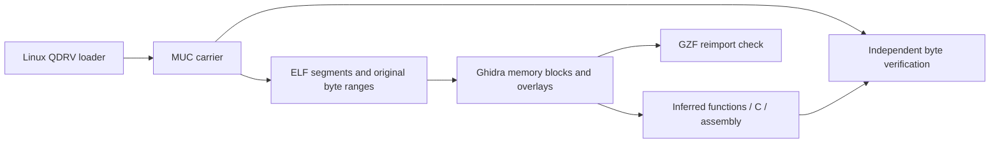

# HGW500 Quantenna MUC firmware

> Public source snapshot. [Scope, provenance and verification](docs/PUBLIC_SNAPSHOT.md).

This private component preserves the generic MUC carrier `qtn_driver.qtn_ruby.0.bin`, its analysis project and independent byte checks. It can be inspected separately from the parent firmware collection.

## How this component fits



This diagram shows software ownership and analysis flow, not a complete board schematic.
The [system architecture](docs/SYSTEM_ARCHITECTURE.md) explains the ARC750 host,
MuC, AuC, DSP and Realtek 8051, with their memory and firmware boundaries.

## What is established

| Area | Recorded scope |
| --- | --- |
| Original checkpoint | 1,137 inferred functions and 110,398 verified Ghidra instructions. |
| Coverage | 41.823% of original file bytes represented by verified instruction ranges; this is not complete semantic recovery. |
| Reopenable analysis | Ghidra 12.1.3, ARCompact:LE:32:default and the pinned extension, with 13-facet GZF roundtrip. |
| Addressing | Keep virtual addresses, physical load fields and repeated-address overlays distinct. Runtime register state remains unknown without its own evidence. |

## Start reading here

1. [Component handoff](docs/PROJECT_HANDOFF.md): inputs, evidence and next work.
2. [System architecture](docs/SYSTEM_ARCHITECTURE.md): processors and firmware families.
3. [Firmware contents](docs/FIRMWARE_MAP.md): OEM, Core Boot R1 and API v2 R3.
4. [Repository map](docs/REPOSITORY_MAP.md): host drivers, payloads and integration.
5. [Published checkout availability](docs/CHECKOUT_AVAILABILITY.md): actual remote source inventory.
6. [Preserved technical notes](docs/REFERENCE_NOTES.md): detailed earlier results, with workstation paths normalized.

## Work in progress

Continue the separate MuC symbol-recovery checkpoint; retain the original export and LP-loop warnings. Byte comparison and GZF preservation do not prove functional equivalence, shutdown safety or hardware acceptance.

## Offline verification


```sh
python tools/verify_public_export.py
```

This checks the published file inventory. Original preservation verifiers and
receipts describe the private source checkpoint; they can require omitted native
databases or external inputs and are not a fresh public-snapshot qualification.

## Preservation and scope

This is a public source snapshot; per-unit data and original private histories remain private. Original vendor/GPL source, notices, comments,
carriers and immutable evidence retain their authorship and provenance. Derived
C is labelled as inferred analysis, not silently presented as original source.
Credentials, unit identity, calibration, personalized rootfs/flash images and
workstation-specific configuration stay outside documentation exports.

Documentation prepared 2026-11-10 from recorded source/evidence. No device access,
firmware installation, radio change or new physical qualification is implied.
